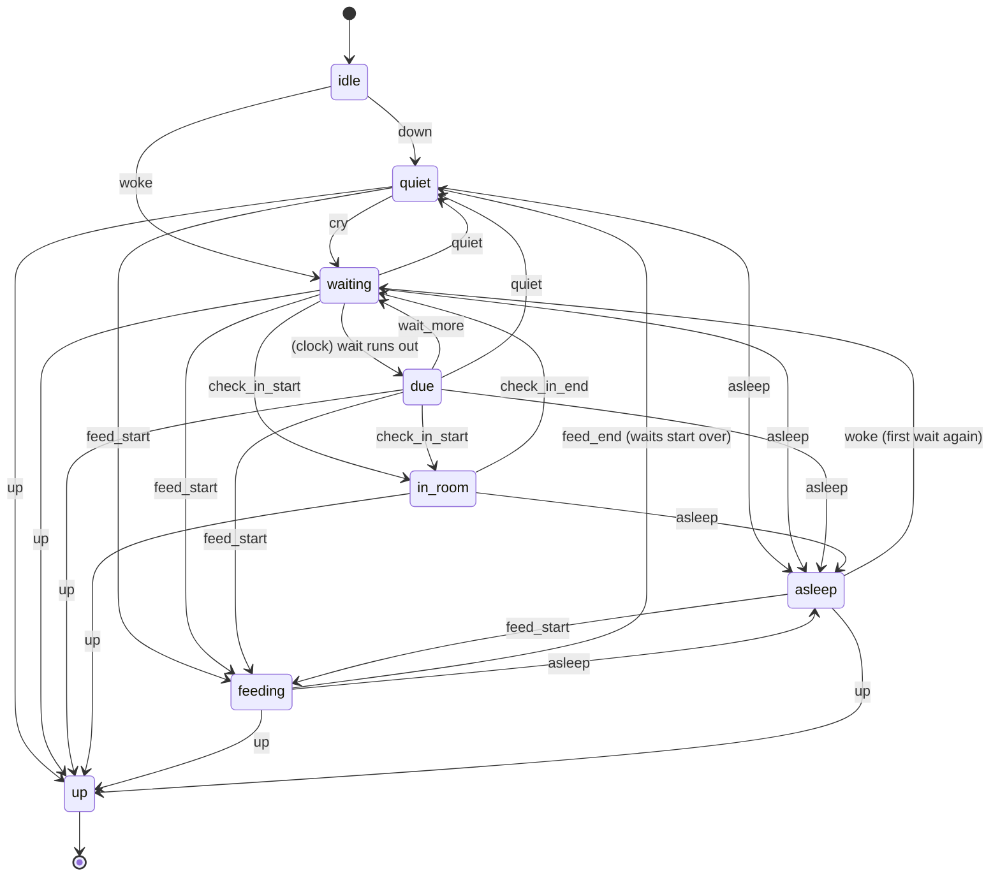

# State machines in Check In

Every part of the app that moves through states, where its rules live, and what
enforces them. **Rule for changes:** a state machine's states and transitions are
declared once, in `src/lib/` (pure, Jest-tested); screens, the store, the background
task and the widget *read* that declaration instead of re-deciding. If you add a
state, an event or a screen that changes one of these, update the declaration and its
tests first, then this page.

Ranked by what's at stake for a parent at 2am.

---

## 1. The night (the core machine)

**Declared in** `src/lib/session.ts`: `NightState` (the states), `allowedActions` (the
transition table), `deriveNightState` / `walk()` (how events move the state), `inProgress`
(which states count as "a night under way"). Tests: `src/lib/__tests__/session.test.ts`
("the night as a state machine" and the rest).

Events are the source of truth; the state is always *derived* from the event log, never stored.

Plus two clock transitions: waiting → due when the wait runs out, and any state → idle
at 11am when the night key rolls over to tonight's night.

**Enforced by**
- `NightStore.tap` (`src/data/NightStore.tsx`): re-reads tonight's night and taps *from
  storage at tap time* and rejects any action `allowedActions` doesn't allow (dev builds log
  a warning). That covers a stale screen, a partner's tap that just synced, a double tap, and
  the 11am rollover.
- `src/app/la.tsx` (Live Activity links) checks `allowedActions` too.
- `walk()` / `episodes()` are tolerant of logs that break the table (History edits, two
  phones before they sync): a second `check_in_start` while already in the room or feeding
  is ignored and not counted.

**Shown by** the Night screen (`src/app/(tabs)/index.tsx`, one block per state), the widget
(`src/widgets/NightActivity.tsx`, which can't import, so its button table is written out;
`la.tsx` guards it), and History's add-a-tap sheet (`EventSheet`, deliberately lenient: it
edits the past).

**Side machines hanging off it**
- Undo (`NightStore.undo`): available for `UNDO_WINDOW_MS` after this phone's tap, only if
  that tap is still the night's latest, and never while another tap is being saved.
- "Not up yet" (`NightStore.notUpYet`): takes back "Up for the day" until 11am.
- Double-tap guard: taps within 800 ms of the last are ignored.

## 2. Which phone rings (duty and alerts)

**Declared in** `src/lib/duty.ts`: `Duty` (`solo | unset | me | partner`), `dutyFor`,
`dutyHere` (a member who left counts as nobody on duty), `isShared`, and **`alertsHere`**,
the single decision "does this phone schedule tonight's alerts and show the Live
Activity": on duty, or not shared, or this phone tapped the step that started the running
wait. Tests: `src/lib/__tests__/duty.test.ts`.

**Used by** `NightStore.reload` (alerts), the Live Activity effect in NightStore, and
`src/data/alarm.ts` (silent-push background task). Don't recompose `dutyFor` +
`alertsOnThisPhone` anywhere else; call `alertsHere`.

**Alert plan** (`src/lib/alertPlan.ts`, tested): what's scheduled for a state: the check-in
alert plus one reminder 3 minutes later while waiting or due; nothing otherwise.
`src/data/notifications.ts` makes the OS match it (never cancels an alert in its last 2 s).

## 3. Unlock and free trial

**Declared in** `src/lib/trial.ts` (`needsUnlock`: 2 free nights, never mid-night). Sources
of "unlocked", ORed in NightStore: this phone's RevenueCat entitlement
(`src/data/purchases.ts`), the family's server unlock (`SyncStatus.unlocked`, written only
by the `revenuecat-webhook`), the dev toggle (dev/screenshot builds only).

Rule: **"not known yet" is never "locked".** Before opening the paywall, `tap` waits up to
3 s for RevenueCat's first answer (`waitForUnlockStatus`). Restore counts a family unlock.
Server side: `unlocks` rows keyed by entitlement `unlock` (grant / revoke / transfer all hit
the same row; `supabase/functions/revenuecat-webhook/logic.ts`, tested).

## 4. Sharing, account and sync

**Where:** `src/data/sync.ts` (`SyncStatus`, `createFamily` / `joinFamily` / `leaveFamily` /
`deleteAccount`, `runOnce`), `src/data/supabase.ts` (`ensureUserId`, `accountKind`),
`src/data/appleAuth.ts`, `src/components/PartnerSection.tsx`.

States (not yet one declared type): account none / anonymous / Apple × sharing off /
waiting for a partner / shared × idle / syncing / error. Members are remembered between
launches (`members` sync value), so an offline phone still knows it shares. Leaving
re-keys this phone's copy (`rekeyLocalData`). Tests: network e2e
(`src/data/__tests__/sync.e2e.test.ts`, `npm run test:sync`).

Rules: **joining downloads everything first**, then swaps this phone's data in one
transaction (`replaceLocalData`), so a dropped connection changes nothing; a partner who
hasn't shared yet undoes the membership. **Two kinds of sync failure:** `error` alone =
offline, retries by itself; `needsSignIn` = this phone's account can't act for the family
(`isSignInProblem` in `src/lib/syncErrors.ts`, tested), shown in Partner sharing with what to
do. **Deleting** an account whose first reply was lost completes on retry (the phone checks
the account is gone). Still one flat `SyncStatus` rather than a declared union (backlog).

## 5. Which screen and theme

**Declared in** `src/lib/nightView.ts` (`chooseView`: Today vs Night, tested). Theme:
`nightMode` in NightStore = clock night (6pm–7am) unless the night is over, or
`inProgress(state)`, or asleep, or "bedtime early" (6 h, in memory).

## 6. Live Activity

**Declared in** `src/lib/liveActivity.ts` (`activityFor`: mode per state, `staleAt` for the
waiting → due flip; tested). Lifecycle in `src/data/liveActivity.ts` (start / update / end,
serialised). Shown only where `alertsHere` is true.

## 7. Smaller flows

| Flow | Where | Notes |
| --- | --- | --- |
| Add a missed night | `src/app/night/add.tsx`, `src/lib/missedNight.ts` (tested) | Saves the night as `addedLater` *before* its taps; errors shown |
| History edit sheet | `src/app/night/[id].tsx`, `src/components/EventSheet.tsx` | `Sheet` union; edits are lenient on purpose |
| Share card | `src/lib/shareCard.ts` (tested) | layout `night` (nights 1–2) / `progress` |
| Review prompt | `src/lib/review.ts` (tested) | at most twice, 120 days apart |
| Onboarding | `src/app/onboarding.tsx` | step indices; low risk |
| Training round | `baby.trainingStartDate`, `currentRound` in `shareCard.ts` | two definitions; see backlog |
