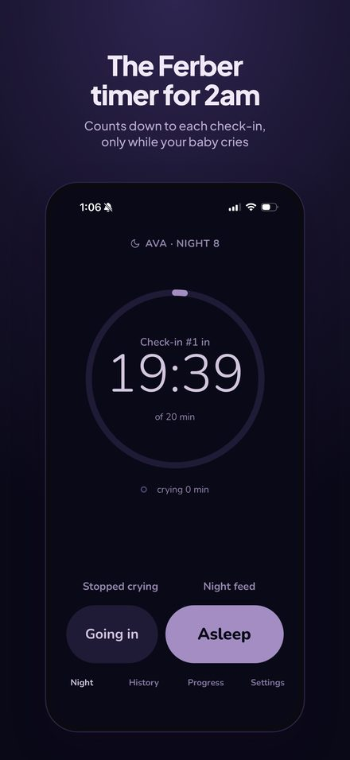
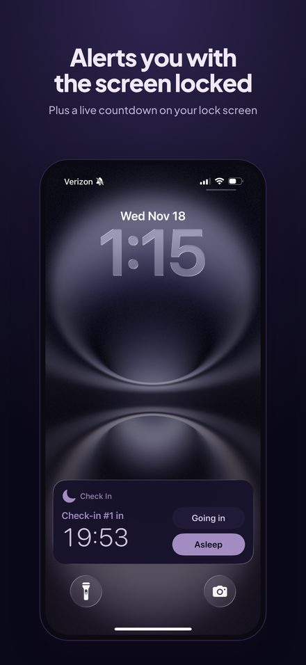
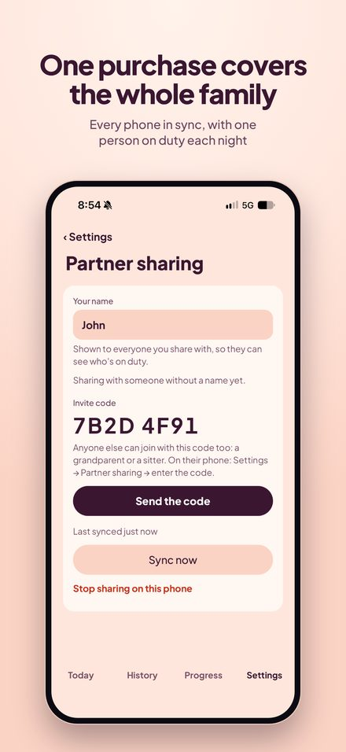
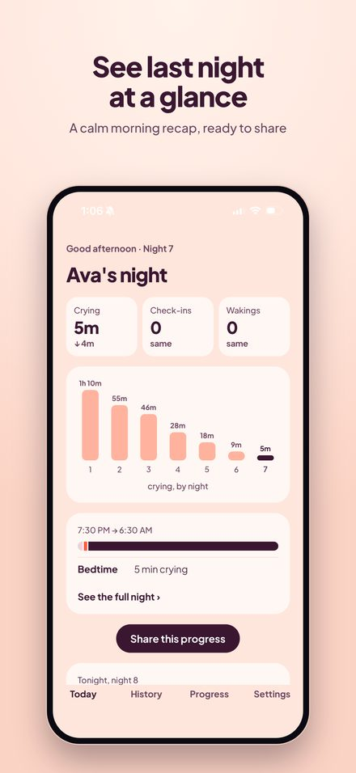
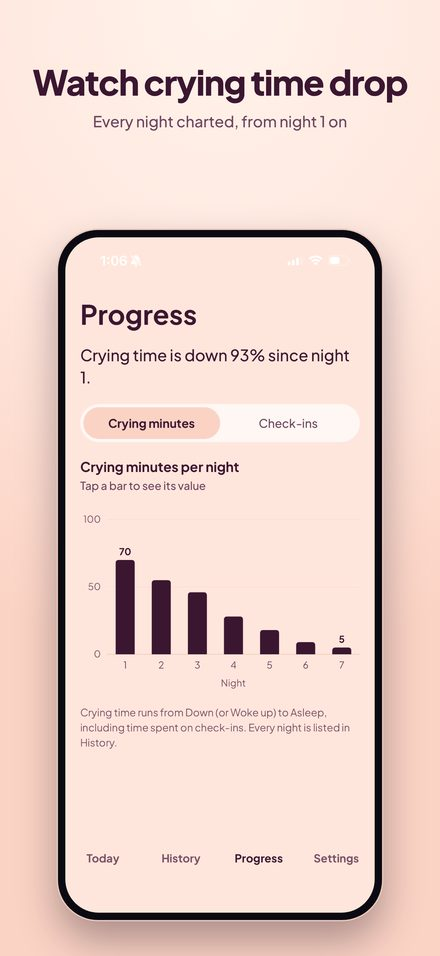
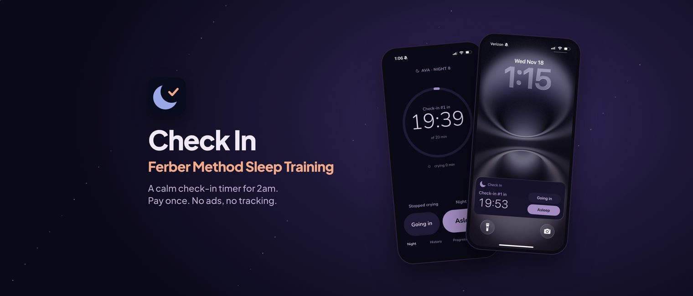

# Press Kit | Check In: Baby Sleep Timer

Source: https://ferbertimer.com/press.html

# Press kit

Writing about baby sleep, sleep training or parenting apps? Everything you need about Check In is on this page. Use any of it freely, and email us for anything else, including a free code to try the full app.

[Download everything (ZIP, 1 MB)](https://ferbertimer.com/press/check-in-press-kit.zip)

## Quick facts

|  |  |
| --- | --- |
| Name | Check In: Baby Sleep Timer (on the home screen: Check In) |
| What it is | An iPhone timer for the Ferber method (graduated check-ins) of baby sleep training |
| Made by | An independent developer, a parent who built it after sleep training their own baby |
| Platform | iPhone |
| Price | Free for the first 2 nights, then $2.99 once. One purchase covers the whole family. No subscription. |
| Privacy | No ads, no tracking, no analytics. No account needed; nights stay on the phone unless the family turns on sharing. |
| Website | [ferbertimer.com](https://ferbertimer.com/) |
| Contact | [askcheckin@gmail.com](mailto:askcheckin@gmail.com) |

## Descriptions

### One line

Check In is a calm iPhone timer for the Ferber method that tells tired parents exactly when to check on their crying baby.

### Short (about 50 words)

Check In is an iPhone timer for the Ferber method of baby sleep training. It counts down to each check-in only while the baby is crying, alerts parents on the lock screen, keeps every phone in the family in sync, and shows crying time dropping night by night. $2.99 once, no subscription, no tracking.

### Long (about 150 words)

The Ferber method is simple on paper: wait a few minutes, check in briefly, wait a little longer. At 2am it is anything but. Parents lose track of which wait they are on, whether the crying stopped long enough to count, and whose turn it is.

Check In does the counting. Parents tap once when the baby goes down; the app times each wait using the Ferber interval chart (or a gentler or custom one), pauses when the baby settles, restarts at the first wait after a night waking, and alerts them on the lock screen when it is time to go in. Every phone in the family stays in sync, with one person on duty each night, and a grandparent or sitter can join too. Each morning brings a calm summary and a chart of crying time across the week.

Check In is free for two nights, then $2.99 once for the whole family. No ads, no tracking.

## What makes it different

- **Built only for the Ferber method,** not a general baby tracker: the waits, check-ins, night wakings and feeds follow how the method works.
- **Counts only while the baby cries.** Quiet stretches don't run the clock.
- **Made for a dark nursery:** a dim night theme, a huge countdown, big buttons, and Undo instead of pop-ups.
- **The whole family in sync,** with a clear "who's on duty tonight" so only one person gets woken up.
- **One price, once.** No subscription, no ads, no data collection.

## Screenshots

Tap a screenshot for the full-size image (1320 × 2868).

Night timerLock-screen alert and live countdownSharing with the whole familyMorning recapCrying time by night

## Icon and banner

App icon, 1024 × 1024 PNG

Banner, 3840 × 1646 JPG.

## Guidelines

- Please call it **Check In** or **Check In: Baby Sleep Timer**.
- Check In is not affiliated with or endorsed by Dr. Richard Ferber.
- Sleep training is meant for healthy babies about 6 months and older, and the app is not medical advice. We'd appreciate it if a mention kept that in.

Want to try the full app, need a different image size, or have a question? Email [askcheckin@gmail.com](mailto:askcheckin@gmail.com).

## Doing this at 2am? The app is built for it

**Check In: Baby Sleep Timer** is the iPhone app from the makers of this page. Unlike a web page, it **alerts you with the phone locked**, only counts while your baby is crying, logs every night so you can see crying time drop, and keeps both parents' phones in sync.

Free for 2 nights, then **$2.99 once** for both parents. No subscription, no ads, no tracking.

[Try the free beta](https://testflight.apple.com/join/mCSprSvf)

The App Store version is coming soon. The beta runs through Apple’s TestFlight app, and unlocking is free while it lasts.
